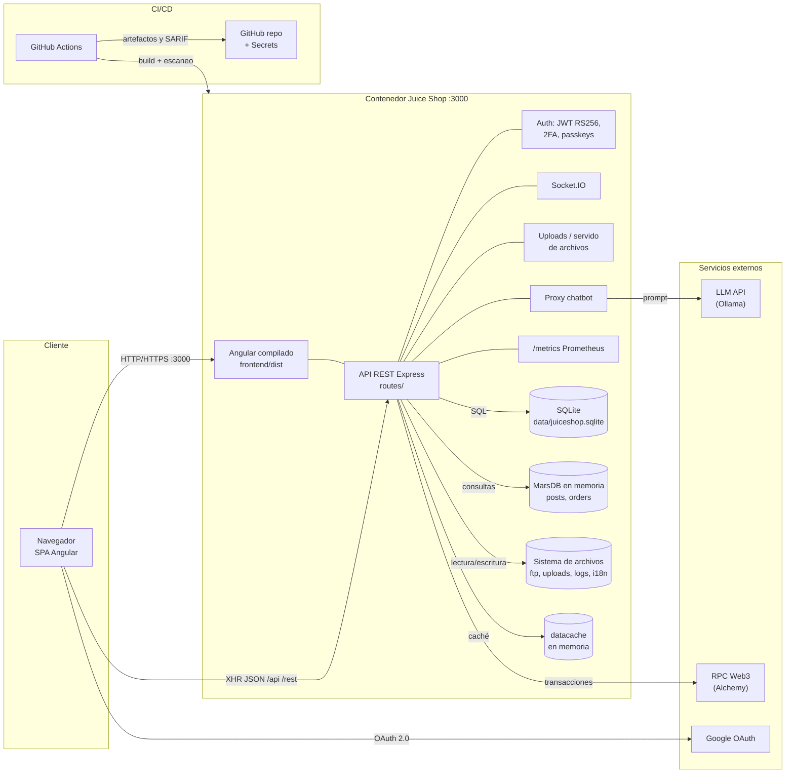
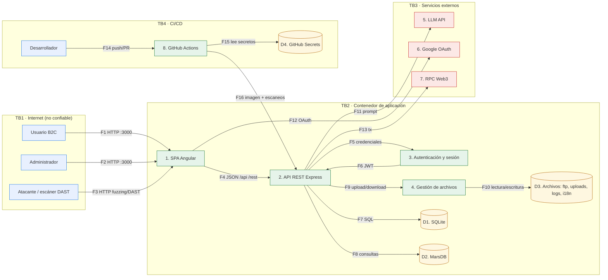

# Guía de implementación — Proyecto final SSDLC sobre OWASP Juice Shop

> **Versión:** 0.1 · **Fecha:** 16-nov-2026
> **Alcance de esta versión:** Fases 0, 1 y 2 (diagnóstico de madurez, diseño y modelado de amenazas).
> **Fuera de alcance por ahora:** Fases 3 a 8 (SAST/secretos, SCA/SBOM, IaC, DAST, guardrails/remediación y plan de pentest).
>
> Documento de trabajo del equipo. Las decisiones aquí descritas se registran también en
> `context/entrega-general.md`. Cualquier cambio de alcance debe reflejarse en ambos archivos.

---

## 0. Cómo usar esta guía

1. Lee la sección 1 (contexto y reglas) antes de tocar el repositorio.
2. Ejecuta las fases **en orden**: la salida de una es la entrada de la siguiente.
3. Cada fase tiene: objetivo, pasos, plantillas, artefactos esperados y checklist de aceptación.
4. Todo artefacto debe quedar **versionado** en la ruta indicada. Las capturas y reportes generados
   que no sean evidencia final van a `reports/` (ignorado por Git).
5. No se corrigen vulns todavía: en estas fases solo se **documenta y prioriza**. La remediación es Fase 7.
6. Regla de oro: si una afirmación no se puede respaldar con un archivo, una captura, un enlace o una
   ejecución reproducible, no va en el documento técnico.

---

## 1. Contexto, reglas y alcance

### 1.1 Datos académicos y hitos

| Dato | Detalle |
|---|---|
| Proyecto | Diseño y proceso de seguridad en el desarrollo de una aplicación |
| Ponderación | 20 puntos (proyecto final) |
| Avance obligatorio | Miércoles **18-nov-2026** (clase 8): madurez inicial, diseño y pipeline con SAST y SCA |
| Entrega y defensa | Miércoles **02-dic-2026** (clase 10): repositorio completo + documento técnico PDF (15–25 páginas) |
| Aplicación elegida | **OWASP Juice Shop** (Node.js, TypeScript, Angular) |
| Repositorio | Fork público `MasterJD/PDDS_Ciberseguridad-Ciclo-Desarrollo-Seguro` |
| Rama de trabajo | `main` para la base; ramas `fase-0`, `fase-1`, … y PRs para cada cambio relevante |

> El último commit antes de la hora límite del 02-dic es lo que se califica. No se califican cambios posteriores.

### 1.2 Reglas no negociables del enunciado

- **Dónde se ejecuta:** solo en contenedores propios (local o en el pipeline). Si se despliega en nube,
  debe ser una cuenta propia, con acceso restringido y destruida al terminar.
- **Pruebas permitidas:** escaneos únicamente contra la instancia del equipo. **Prohibido** escanear
  demos públicas de Juice Shop u otros sistemas.
- **Secretos:** ningún token, contraseña o llave real en el repositorio. Todo va en *GitHub Secrets*
  (`Settings → Secrets and variables → Actions`).
- **IA:** se permite si se declara. El equipo debe poder explicar y defender todo lo entregado.
- **Pipeline:** en cada PR hacia `main`, con umbrales de bloqueo reales (sin `|| true` ni
  `continue-on-error` en los gates) y permisos mínimos del token (`permissions: contents: read` por defecto).

### 1.3 Cómo se evalúa (rúbrica → evidencia)

| Criterio | Puntos | Fase(s) que lo evidencian | Evidencia principal |
|---|---:|---|---|
| Diseño y requisitos | 3 | 1 | Arquitectura, DFD con límites de confianza, clasificación de datos, ≥10 requisitos ASVS |
| Modelo de amenazas | 3 | 2 | ≥12 amenazas STRIDE con mitigación y trazabilidad |
| Pipeline (secretos, SAST, SCA, IaC, DAST) | 6 | 3, 4, 5, 6 | Workflow con las etapas y reportes/SBOM |
| Guardrails y política de bloqueo | 2 | 7 | Protección de rama, checks obligatorios, política justificada |
| Remediación y gestión | 2 | 7 | ≥5 hallazgos corregidos con PR + DefectDojo + ≥1 VEX |
| Plan de pentest y madurez | 2 | 0 y 8 | Plan basado en el modelo + comparación antes/después |
| Defensa oral | 2 | Todas | Demo en vivo y explicación de ambos integrantes |

**Puntos extra (hasta 2):** DAST autenticado en el pipeline o reglas SAST propias.

---

## 2. Estado del repositorio base tras la limpieza

### 2.1 Qué se conservó (y por qué)

| Componente | Ruta | Motivo |
|---|---|---|
| Backend Express + TypeScript | `app.ts`, `server.ts`, `routes/`, `lib/`, `models/` | Es la aplicación a analizar y desplegar |
| Frontend Angular | `frontend/` | Necesario para que la app funcione y para DAST |
| Datos semilla | `data/` (`users.yml`, `deliveries.yml`, `securityQuestions.yml`, i18n) | Permite arrancar con catálogo y usuarios |
| Configuración | `config/` | Define puerto, productos, dominio y features |
| Docker | `Dockerfile`, `docker-compose.test.yml` | Base para la Fase 5 (se endurecerá) |
| API spec | `swagger.yml` | Insumo para ZAP API scan (Fase 6) |
| Modelo Threat Dragon base | `threat-model.json` | Punto de partida para la Fase 2 (no tiene amenazas aún) |
| Pruebas | `test/`, `cypress/`, `frontend/**/*.spec.ts` | Red de seguridad y ejemplos de pruebas |
| Documentación legal | `LICENSE`, `SECURITY.md` | Licencia MIT y política de reporte |
| Claves | `encryptionkeys/jwt.pub` | **Requerida en tiempo de carga** por `lib/insecurity.ts` |

### 2.2 Qué se retiró

| Elemento retirado | Motivo |
|---|---|
| `SOLUTIONS.md`, `REFERENCES.md`, `HALL_OF_FAME.md` | Documentación de la comunidad upstream, sin relación con el proyecto |
| `screenshots/` | Capturas usadas por el README upstream |
| `monitoring/` | Dashboard de Grafana de la demo de Juice Shop |
| `vagrant/` | Aprovisionamiento Vagrant; el proyecto usa contenedores |
| `infrastructure/` y `terraform/` | IaC **intencionalmente insegura** usada por retos de Juice Shop; se reemplazará por `infra/` propia en la Fase 5 |
| `rsn/` | *Refactoring Safety Net* exclusivo de los retos de Juice Shop |
| `data/static/codefixes/` | Parches de los retos de código; código deliberadamente vulnerable que ensuciaría SAST/SCA |
| `data/static/web3-snippets/` | Fragmentos de los retos Web3 |
| `ftp/*` (excepto `.gitkeep`) | Archivos “filtrados” a propósito para retos (backups, cupones, etc.) |
| `encryptionkeys/premium.key` | Artefacto del reto de paywall |
| `ctf.key` | Clave HMAC del modo CTF |
| `app.json` | Descriptor de despliegue en Heroku |
| `crowdin.yaml`, `.codeclimate.yml`, `.mailmap` | Integraciones de la comunidad upstream |
| `CONTRIBUTING.md`, `CODE_OF_CONDUCT.md` | Guías de contribución ajenas al alcance del curso |
| `data/static/challenges.yml` | Catálogo de retos vaciado (`[]`); ver nota abajo |

**Nota sobre los retos:** el motor (`lib/challengeUtils.ts`, `models/challenge.ts`, rutas `/api/Challenges`,
Score Board) se mantiene para no romper la aplicación. Al vaciar el catálogo, el Score Board queda vacío y
las llamadas `challengeUtils.solveIf(...)` no hacen nada. Se añadió una guarda en `data/datacreator.ts`
para que el arranque no falle al no existir `changeProductChallenge`. Las cadenas de i18n de los retos se
conservan porque son inertes y editarlas en 44 archivos añade riesgo sin beneficio.

**Consecuencia esperada:** las pruebas que asumen retos concretos (varias de `test/api/` y la mayoría de
`cypress/e2e/`) fallarán. No se eliminan: se excluirán de los gates obligatorios o se ajustarán cuando se
escriban las pruebas del proyecto. Esto debe quedar registrado como deuda conocida en la entrega.

### 2.3 Estructura objetivo a crear (solo lo que aplica a Fases 0–2)

```text
security/
  madurez/
    samm-inicial.md            # Fase 0 (tabla de prácticas, nivel actual y objetivo)
    samm-final.md              # Fase 8 (se creará al final)
  diseno/                      # equivale a "diseño" del enunciado; se usa sin ñ por compatibilidad
    arquitectura.md            # Fase 1 (diagramas de componentes y despliegue)
    dfd.md                     # Fase 1 (DFD + límites de confianza)
    clasificacion-datos.md     # Fase 1
    requisitos-asvs.md         # Fase 1 (≥10 requisitos)
  threat-model/
    juice-shop.tm.json         # Fase 2 (modelo Threat Dragon versionado)
    amenazas.md                # Fase 2 (registro de amenazas)
    trazabilidad.md            # Fase 2 (amenaza → ASVS → control → evidencia)
  sbom/                        # Fase 4 (vacío por ahora)
  vex/                         # Fase 4 (vacío por ahora)
  politica-de-bloqueo.md       # Fase 7 (borrador desde Fase 3)
  pentest-plan.md              # Fase 8
infra/                         # Fase 5 (Dockerfile endurecido, compose/Terraform, etc.)
.github/workflows/devsecops.yml # Fases 3–6
.semgrep/                      # Fase 3
.zap/rules.tsv, .zap/plan.yaml # Fase 6
```

> `security/diseno/` se usa sin tilde para evitar problemas de codificación en rutas, CI y URLs.
> En el documento técnico se puede citar como “Diseño”.

### 2.4 Convenciones del equipo

| Tema | Convención |
|---|---|
| Idioma de documentación | Español; identificadores de código y nombres de archivo técnicos en inglés |
| IDs de amenazas | `T-01` … `T-16` (estables, no se renumeran) |
| IDs de requisitos | `REQ-01` … `REQ-nn`, con columna `ASVS` que cita el ID oficial |
| Severidad | Impacto × Probabilidad (1–5 cada uno), ver §5.3 |
| Evidencia | Enlace al archivo/PR/artefacto + fecha; capturas en `reports/` solo si no son versionables |
| Commits | `fase-N: <descripción>`; firma DCO (`git commit -s`) |
| PRs | Un PR por fase o por corrección; descripción con “antes/después” y evidencia |
| Secretos | Nunca en el repo; `.env` local ignorado; GitHub Secrets en CI |
| Nombres de rama | `fase-0-madurez`, `fase-1-diseno`, `fase-2-amenazas`, … |

---

## 3. Fase 0 — Diagnóstico de madurez

**Objetivo:** evaluar el estado inicial del proyecto con OWASP SAMM (o DSOMM) y definir el nivel objetivo.
**Entregable:** tabla de prácticas con nivel actual y objetivo.
**Ruta:** `security/madurez/samm-inicial.md`.

### 3.1 Método

1. Usar **OWASP SAMM v2** (15 prácticas, 5 funciones de negocio, niveles 0–3). Es más adecuado que DSOMM
   porque el proyecto incluye diseño, requisitos y modelo de amenazas, no solo CI/CD.
2. Evaluar **solo lo que existe en este fork**, no lo que Juice Shop upstream tenga en GitHub.
   Fuentes de evidencia: árbol del repo, `package.json`, `Dockerfile`, `config/`, historial de PRs,
   configuración de la rama `main` (captura de *Branch protection*), ejecuciones de Actions.
3. Puntuar cada práctica con la regla SAMM: el nivel se alcanza solo si **todas** las actividades del
   nivel están implementadas y hay evidencia. No se autodeclara: se justifica.
4. El nivel objetivo debe ser alcanzable en el tiempo del proyecto. Recomendación: **nivel 2 en
   Threat Assessment, Security Requirements, Secure Build y Security Testing; nivel 1 en el resto.**
5. Guardar una captura de la configuración de `main` y del historial de Actions como anexo.

### 3.2 Plantilla de tabla (borrador inicial a validar por el equipo)

> Los niveles de la columna “Actual (borrador)” son una **hipótesis de trabajo** basada en el estado del
> repositorio. El equipo debe confirmarlos o corregirlos con evidencia antes de entregar.

| Función | Práctica | Pregunta clave | Actual (borrador) | Objetivo | Evidencia / justificación | Acción para cerrar la brecha |
|---|---|---|---:|---:|---|---|
| Governance | Strategy & Metrics (SM) | ¿Hay métricas de seguridad y objetivos medibles? | 0 | 1 | No hay tablero ni métricas de AppSec; solo métricas técnicas `/metrics` | Definir 3 métricas (MTTR, hallazgos por PR, cobertura de gates) |
| Governance | Policy & Compliance (PC) | ¿Existe política de seguridad y requisitos aplicables? | 0 | 1 | Solo `SECURITY.md` de reporte de vulns | Redactar `security/politica-de-bloqueo.md` (Fase 7) |
| Governance | Education & Guidance (EG) | ¿Se capacita y se dan guías al equipo? | 0 | 1 | No hay guía interna | Esta guía + checklist de PR |
| Design | Threat Assessment (TA) | ¿Se modelan amenazas por cambio de diseño? | 0 | 2 | Existe `threat-model.json` sin amenazas y sin proceso | Fase 2 completa y revisión por PR |
| Design | Security Requirements (SR) | ¿Se derivan requisitos de seguridad? | 0 | 2 | No hay ASVS en el repo | Fase 1: ≥10 requisitos ASVS L2 |
| Design | Secure Architecture (SA) | ¿La arquitectura aplica principios de diseño seguro? | 1 | 1 | Contenedor non-root y separación SPA/API, pero CORS abierto y claves embebidas | Documentar y planificar correcciones (Fase 7) |
| Implementation | Secure Build (SB) | ¿El build es reproducible y usa componentes verificados? | 1 | 2 | `Dockerfile` + script `sbom`, pero `package-lock.json` está ignorado por Git | Versionar lockfiles, SBOM en cada build (Fase 4) |
| Implementation | Secure Deployment (SD) | ¿El despliegue aplica hardening y mínimos privilegios? | 0 | 2 | `Dockerfile` upstream sin digest ni políticas de runtime | `infra/` endurecida (Fase 5) |
| Implementation | Defect Management (DM) | ¿Hay un flujo único de hallazgos y SLA? | 0 | 1 | No hay DefectDojo ni tablero | Fase 7: DefectDojo + SLA |
| Verification | Architecture Assessment (AA) | ¿Se revisa la arquitectura contra el modelo? | 0 | 1 | Sin revisión formal | Revisión en cada PR que cambie DFD |
| Verification | Requirements-driven Testing (RT) | ¿Se prueban los requisitos de seguridad? | 0 | 1 | Pruebas funcionales, no de seguridad | Casos de prueba derivados de ASVS (Fase 8) |
| Verification | Security Testing (ST) | ¿Hay SAST/DAST/SCA automatizados? | 0 | 2 | El fork no tiene `.github/workflows/` | Fases 3, 4 y 6 |
| Operations | Incident Management (IM) | ¿Hay proceso de respuesta a incidentes? | 0 | 1 | Solo `SECURITY.md` | Definir contacto y runbook mínimo |
| Operations | Environment Management (EM) | ¿Los entornos están endurecidos y separados? | 0 | 1 | Solo entorno local | `infra/` + compose local (Fase 5) |
| Operations | Operational Management (OM) | ¿Hay logs, métricas y alertas? | 1 | 2 | Morgan + `/metrics` Prometheus; sin alertas | Alertas y retención de logs |

**Resumen para el documento:** contar prácticas por nivel, calcular el porcentaje de prácticas en nivel
≥1 y ≥2 antes y después. Guardar la tabla como base para la comparación de la Fase 8.

### 3.3 Checklist de aceptación — Fase 0

- [ ] Están las 15 prácticas SAMM con nivel actual justificado.
- [ ] Cada nivel actual tiene evidencia verificable (archivo, captura o enlace).
- [ ] El nivel objetivo está definido y es coherente con el tiempo disponible.
- [ ] Hay una tabla resumen (conteo por nivel) y una lista de brechas priorizadas.
- [ ] El documento está en `security/madurez/samm-inicial.md` y referenciado en la entrega.

---

## 4. Fase 1 — Diseño de la aplicación

**Objetivo:** documentar arquitectura, flujo de datos, clasificación de datos y requisitos de seguridad.
**Entregable:** diseño con diagramas y tabla de requisitos (≥10 ASVS nivel 1 o 2).
**Rutas:** `security/diseno/arquitectura.md`, `dfd.md`, `clasificacion-datos.md`, `requisitos-asvs.md`.

### 4.1 Hechos de arquitectura verificados en el código

| Hecho | Fuente |
|---|---|
| Un solo proceso Node.js sirve la SPA Angular compilada y la API REST | `server.ts` (`express.static('frontend/dist/frontend')`) |
| Express 4 + TypeScript; Socket.IO en el mismo servidor HTTP | `server.ts`, `lib/startup/registerWebsocketEvents.ts` |
| SQLite vía Sequelize en `data/juiceshop.sqlite`; se recrea en cada arranque (`sync({ force: true })`) | `models/index.ts`, `server.ts` |
| MarsDB en memoria para reseñas y pedidos (`posts`, `orders`) | `data/mongodb.ts` |
| Autenticación con JWT RS256 (expira en 6 h); contraseñas con MD5; 2FA TOTP y passkeys disponibles | `lib/insecurity.ts`, `routes/login.ts`, `routes/2fa.ts`, `routes/passkey.ts` |
| El frontend guarda el JWT en `localStorage` y lo envía como `Authorization: Bearer` | `frontend/src/app/Services/request.interceptor.ts` |
| Archivos servidos desde `ftp/`, `uploads/`, `logs/`, `i18n/`, `encryptionkeys/` | `server.ts` |
| Métricas Prometheus en `/metrics` | `routes/metrics.ts`, `server.ts` |
| Integraciones externas: LLM (Ollama en `localhost:11434`), Google OAuth (frontend), Web3/Alchemy (env) | `config/default.yml`, `frontend/src/app/Services/user.service.ts`, `routes/web3Wallet.ts` |
| Empaquetado/despliegue: `Dockerfile` multi-stage, imagen final `distroless/nodejs24`, usuario `65532` | `Dockerfile` |

### 4.2 Diagrama de componentes (pegar en `arquitectura.md`)



**Despliegue local (para `arquitectura.md`):**

```text
[Host] docker run -p 3000:3000 juice-shop-ssdlc
   └─ Contenedor distroless, usuario 65532
        ├─ :3000 Express + Angular + Socket.IO
        ├─ /juice-shop/data/juiceshop.sqlite (efímero)
        ├─ /juice-shop/logs (volumen opcional)
        └─ salida a LLM/OAuth/Web3 según configuración
```

Indicar explícitamente: **no hay base de datos externa ni cola de mensajes**; el estado persistente real
es el sistema de archivos. Esto simplifica el DFD y el despliegue.

### 4.3 DFD con límites de confianza (pegar en `dfd.md`)

Niveles de confianza propuestos:

| ID | Límite | Qué separa |
|---|---|---|
| TB1 | Internet ↔ aplicación | Navegador/atacante frente al contenedor |
| TB2 | Aplicación ↔ sistema de archivos | Procesos Express frente a datos persistidos |
| TB3 | Aplicación ↔ servicios externos | LLM, OAuth, Web3 |
| TB4 | Repositorio/CI ↔ artefacto desplegado | Código y secretos de Actions frente a la imagen |



Reglas del DFD:

- Cada flujo debe tener origen, destino y datos que viaja (F1…F16).
- Cada proceso y almacén debe aparecer en el registro de amenazas (Fase 2).
- Los flujos que cruzan TB1→TB2 son los de mayor exposición y deben priorizar controles DAST.

### 4.4 Clasificación de datos (pegar en `clasificacion-datos.md`)

Escala usada: **Público → Interno → Confidencial → Restringido (crítico)**.

| Dato | Dónde vive | Sensibilidad | Ejemplo / entidad | Nota de seguridad |
|---|---|---|---|---|
| Contraseñas de usuarios | SQLite `Users.password` | Restringido | Hash MD5 (heredado, intencionalmente débil) | Debe migrar a Argon2id; nunca loggear |
| Respuestas de seguridad | SQLite `SecurityAnswers` | Restringido | Pregunta/respuesta de recuperación | Permite *account takeover* si se filtra |
| Secretos TOTP | SQLite `Users.totpSecret` | Restringido | 2FA | Cifrar en reposo y restringir acceso |
| Credenciales de passkey | SQLite `Passkeys` | Confidencial | Clave pública, contador | La clave privada nunca sale del autenticador |
| Tokens de sesión | `localStorage` del navegador + memoria | Restringido | JWT RS256 (6 h) | Expuesto a XSS; ideal cookie `HttpOnly` |
| Token deluxe | JWT `deluxeToken` | Confidencial | HMAC-SHA256 sobre email+rol | Verificar siempre en servidor |
| PII de usuario | SQLite `Users`, `Addresses`, `Memories` | Confidencial | Email, IP de login, nombre, dirección, teléfono, foto | Datos personales; aplica minimización y borrado |
| Datos de pago | SQLite `Cards` | Restringido | Número de tarjeta, titular, vencimiento | **No** debe almacenarse PAN completo; simulado |
| Pedidos y facturas | MarsDB `orders` + PDF | Confidencial | `orderId`, email, productos, total | Enumeración de pedidos es un riesgo |
| Reseñas y fotos | MarsDB `posts`, `uploads/` | Público | Comentarios, imágenes | UGC: validar y sanear |
| Quejas y feedback | SQLite `Complaints`, `Feedbacks` | Confidencial | Texto libre + usuario | Puede contener PII |
| Solicitudes de privacidad | SQLite `PrivacyRequests` | Confidencial | Solicitud de borrado/exportación | Trazabilidad legal |
| Logs de acceso y auditoría | `logs/` | Confidencial | IP, user-agent, ruta | Retención limitada; sin credenciales |
| Métricas | `/metrics` | Interno | Contadores Prometheus | No exponer públicamente |
| Claves criptográficas | `encryptionkeys/`, `lib/insecurity.ts` | Restringido | `jwt.pub`, clave privada embebida | **Hallazgo**: la privada está en el código |
| Catálogo de productos | SQLite `Products`, assets | Público | Nombre, precio, imagen | Integridad crítica (precio) |
| Documentos de seguridad | `security/` | Interno | DFD, modelo de amenazas, SBOM | No publicar en la app |
| SBOM | `security/sbom/` | Interno | Componentes y versiones | Revela versiones; no publicar |

Añadir en el mismo archivo: **flujo de retención** (la BD se recrea en cada arranque; `logs/` y `uploads/`
persisten si hay volumen), **base legal** (datos simulados de una tienda ficticia) y **regla de no usar
datos reales** en la instancia del proyecto.

### 4.5 Requisitos de seguridad ASVS (pegar en `requisitos-asvs.md`)

Base: **OWASP ASVS 4.0.3, nivel 2** (con algunos L1). Los textos son paráfrasis de trabajo: antes de la
entrega, validar el texto literal en la versión oficial y citar el ID exacto.

| ID | ASVS | Requisito (paráfrasis) | Nivel | Aplica a | Verificación |
|---|---|---|---|---|---|
| REQ-01 | V1.1.2 | Modelar amenazas para cada cambio de diseño y mantenerlo actualizado | 2 | Proceso | Revisión del modelo en PR |
| REQ-02 | V2.1.1 | Contraseñas de al menos 12 caracteres, sin truncamiento | 1 | `routes/login.ts`, registro | Prueba + revisión |
| REQ-03 | V2.1.7 | Verificar contraseñas contra listas de filtradas | 2 | Registro/cambio de clave | Prueba |
| REQ-04 | V2.2.1 | Controles anti-automatización en login y recuperación | 1 | `/rest/user/login`, reset | ZAP + prueba de carga |
| REQ-05 | V2.8.1 | 2FA con TOTP de tiempo limitado y verificación en servidor | 2 | `routes/2fa.ts` | Prueba de integración |
| REQ-06 | V3.2.1 | Tokens de sesión generados con CSPRNG en servidor | 1 | `lib/insecurity.ts` | Revisión + SAST |
| REQ-07 | V3.3.1 | El logout invalida la sesión en servidor | 1 | `routes/currentUser*` | Prueba |
| REQ-08 | V3.4.1/3.4.2 | Cookies de sesión con `Secure` y `HttpOnly` | 2 | Configuración de sesión | Revisión + DAST |
| REQ-09 | V3.5.2 | Tokens autocontenidos firmados y verificados | 1 | JWT RS256 | Revisión + prueba de manipulación |
| REQ-10 | V3.5.3 | Tokens autocontenidos con expiración corta | 1 | JWT (6 h) | Revisión |
| REQ-11 | V4.1.1 | Mínimo privilegio y denegar por defecto en API | 1 | `server.ts`, `security.isAuthorized()` | Prueba de roles |
| REQ-12 | V4.2.1 | Prevención de IDOR en datos y API | 1 | `/rest/basket/:id`, `/api/Users/:id` | Prueba manual/DAST autenticado |
| REQ-13 | V4.3.1 | Interfaces administrativas con autenticación y autorización fuertes | 2 | `/api/Quantitys`, `/rest/order-history/orders` | Revisión |
| REQ-14 | V5.1.3 | Validación de entrada positiva y con listas permitidas | 1 | Todas las rutas con body/query | SAST + pruebas |
| REQ-15 | V5.2.1 | Sanear HTML no confiable en reseñas, feedback y nombres | 1 | `routes/*Products*`, `feedback` | SAST + DAST |
| REQ-16 | V5.3.4 | Consultas parametrizadas / ORM en todo acceso SQL | 1 | `routes/login.ts`, `lib/*` | SAST (Semgrep/CodeQL) |
| REQ-17 | V5.5.1/5.5.2 | Serialización segura y deserialización restringida | 2 | uploads XML/YAML/JSON | SAST + pruebas |
| REQ-18 | V6.2.5 | Hash de contraseñas con algoritmo adaptativo (Argon2id/bcrypt) | 2 | `lib/insecurity.ts` | Revisión + SAST |
| REQ-19 | V6.3.1 | Aleatoriedad criptográficamente segura | 1 | captchas, tokens, IDs | Revisión + SAST |
| REQ-20 | V6.4.1 | Claves gestionadas fuera del código y rotables | 2 | `encryptionkeys/`, `lib/insecurity.ts` | Revisión + secret scanning |
| REQ-21 | V7.1.1 | No registrar datos sensibles ni credenciales | 1 | `logs/`, `lib/logger.ts` | SAST + revisión de logs |
| REQ-22 | V7.4.1 | Mensajes de error genéricos al usuario | 2 | `errorhandler`, rutas | DAST + revisión |
| REQ-23 | V7.4.2 | Manejo de errores “fail secure” | 2 | middlewares | Revisión + pruebas |
| REQ-24 | V9.1.1 | TLS en todas las conexiones expuestas | 2 | Reverse proxy / despliegue | Revisión de `infra/` |
| REQ-25 | V11.1.1 | Controles de lógica de negocio en servidor (precio, cupones, stock) | 1 | `routes/basket*`, `order.ts`, `coupon.ts` | Pruebas de abuso |
| REQ-26 | V11.1.2 | Prevención de condiciones de carrera | 2 | carrito, stock, wallet | Pruebas concurrentes |
| REQ-27 | V12.1.1 | Límite de tamaño de archivos procesables | 1 | `/file-upload`, `/profile/image/*` | Prueba + DAST |
| REQ-28 | V12.2.1 | Validación de tipo de archivo por contenido, no por extensión | 1 | uploads | SAST + prueba |
| REQ-29 | V12.4.1 | Archivos no confiables fuera de la raíz web y con permisos mínimos | 2 | `ftp/`, `uploads/` | Revisión + IaC |
| REQ-30 | V12.5.1 | Prevención de path traversal | 1 | servidores de archivos | SAST + DAST |
| REQ-31 | V12.6.1 | Protección SSRF en URLs controladas por el usuario | 2 | `profileImageUrlUpload`, webhooks | SAST + prueba |
| REQ-32 | V13.1.1 | Mismos controles de seguridad en API que en la web | 1 | `/api/*`, `/rest/*` | Revisión + DAST |
| REQ-33 | V13.2.1 | Restringir métodos HTTP permitidos por endpoint | 1 | `server.ts`, finale-rest | Revisión + ZAP |
| REQ-34 | V13.2.3 | Validar el esquema JSON de las peticiones | 2 | API REST | SAST + pruebas |
| REQ-35 | V14.1.1 | Endurecer el build y eliminar artefactos innecesarios | 1 | `Dockerfile`, `infra/` | Checkov/Trivy |
| REQ-36 | V14.2.1 | Inventario de dependencias (SBOM) en cada build | 2 | CI | Syft/cdxgen |
| REQ-37 | V14.2.2 | Sin componentes vulnerables conocidos | 1 | CI | Grype/Trivy/OSV |
| REQ-38 | V14.3.1 | Sin modo debug ni trazas detalladas en producción | 1 | `NODE_ENV`, error handler | Revisión + DAST |
| REQ-39 | V14.4.1 | Cabeceras de seguridad (HSTS, `X-Content-Type-Options`, etc.) | 1 | `helmet`, `infra/` | ZAP + revisión |
| REQ-40 | V14.5.3 | CORS restrictivo por origen y método | 1 | `server.ts` (`cors()` abierto) | Revisión + DAST |

**Selección mínima para la entrega:** REQ-01 a REQ-16 (16 requisitos) cubren autenticación, sesión,
control de acceso, validación, criptografía, errores y archivos. Los demás quedan como catálogo ampliado.

En `requisitos-asvs.md` añadir, por cada requisito, una columna **“Estado inicial”** (Cumple / No cumple /
Parcial / No verificable) y **“Cómo se verificará”** (prueba manual, SAST, SCA, DAST, revisión). Ese mapeo
es el insumo directo de la Fase 2 y de los gates de la Fase 7.

### 4.6 Checklist de aceptación — Fase 1

- [ ] Diagrama de componentes con frontend, backend, almacenes y servicios externos.
- [ ] Diagrama de despliegue (contenedor único, puerto 3000, volúmenes, usuario no root).
- [ ] DFD con actores, procesos, almacenes, flujos numerados y **4 límites de confianza**.
- [ ] Clasificación de datos con sensibilidad, ubicación y nota de seguridad.
- [ ] ≥10 requisitos ASVS (recomendado 16) con ID, nivel, módulo y verificación.
- [ ] Los diagramas renderizan (Mermaid en GitHub o exportados a PNG/PDF en el documento).
- [ ] Todo está en `security/diseno/` y enlazado desde la entrega.

---

## 5. Fase 2 — Modelado de amenazas

**Objetivo:** aplicar STRIDE sobre el DFD e identificar ≥12 amenazas con mitigación y trazabilidad.
**Entregable:** modelo de Threat Dragon (JSON) + tabla de amenazas + matriz de trazabilidad.
**Rutas:** `security/threat-model/juice-shop.tm.json`, `amenazas.md`, `trazabilidad.md`.

### 5.1 Procedimiento con OWASP Threat Dragon

1. Instalar **OWASP Threat Dragon** (escritorio) o usar la versión web.
2. Crear un modelo nuevo con metodología **STRIDE** y título `Juice Shop — SSDLC`.
3. Importar `threat-model.json` (ya está en la raíz del repo) como DFD base. Revisar que los elementos
   coincidan con el DFD de la Fase 1; añadir los que falten (CI/CD, LLM, base de datos, archivos).
4. Dibujar/ajustar los **límites de confianza** TB1–TB4 y renombrar los flujos como F1–F16.
5. Añadir amenazas por elemento: clic derecho → *Add threat*. Completar:
   - **Título** corto y específico.
   - **Categoría STRIDE**.
   - **Estado** (Open / Mitigated / Accepted).
   - **Severidad** (High/Medium/Low) coherente con la matriz de §5.3.
   - **Mitigación** y **referencias** (ASVS, CWE, OWASP Cheat Sheet).
6. Guardar como `security/threat-model/juice-shop.tm.json` (JSON del modelo) y exportar el DFD a PDF/PNG.
7. Validar que hay **al menos una amenaza por cada letra de STRIDE** y ≥12 en total.
8. Versionar el JSON en Git; cualquier cambio de diseño debe actualizarlo en el mismo PR.

### 5.2 Registro de amenazas inicial (pegar y completar en `amenazas.md`)

Escala: Impacto (I) y Probabilidad (P) de 1 a 5. Prioridad = I × P (ver §5.3).

| ID | STRIDE | Elemento / flujo | Amenaza | I | P | Prioridad | Mitigación propuesta | ASVS |
|---|---|---|---|---:|---:|---|---|---|
| T-01 | Spoofing | F5/F6 login, `routes/login.ts` | Fuerza bruta y enumeración de usuarios; hash MD5 permite cracking offline | 4 | 5 | 20 Crítica | Rate limit + bloqueo progresivo, errores genéricos, Argon2id | REQ-02, 03, 04, 18, 22 |
| T-02 | Spoofing | F6 JWT, `lib/insecurity.ts` | Clave privada RSA embebida en el repositorio permite forjar tokens de cualquier usuario | 5 | 4 | 20 Crítica | Sacar claves del código, rotarlas, usar secreto de CI, verificar `kid`/claims | REQ-09, 10, 20 |
| T-03 | Tampering | F4/F7 carrito y productos | El precio y el total se aceptan desde el cliente; `PUT /api/Products/:id` queda sin autorización | 4 | 4 | 16 Crítica | Recalcular precio y stock en servidor; autorizar toda escritura | REQ-11, 25, 32 |
| T-04 | Tampering | F7 login SQL | Inyección SQL por concatenación en `SELECT ... WHERE email = '${...}'` | 5 | 5 | 25 Crítica | Consultas parametrizadas / ORM; validación de entrada | REQ-14, 16 |
| T-05 | Repudiation | F9 logs, `logs/` | Ausencia de eventos de seguridad y posible registro de PII/credenciales | 3 | 4 | 12 Alta | Log de auditoría estructurado, sin PII, con retención y alertas | REQ-21 |
| T-06 | Information disclosure | F9/F10 `ftp/`, backups | Listado de directorios y backups/cupones expuestos públicamente | 4 | 4 | 16 Crítica | Eliminar listado, allowlist de archivos, permisos mínimos | REQ-29, 30 |
| T-07 | Information disclosure | F1/F4 `localStorage` + XSS | Robo del JWT por XSS almacenado/reflejado (reseñas, perfil, búsqueda) | 4 | 4 | 16 Crítica | Sanear/salida contextual, CSP estricta, valorar cookie `HttpOnly` | REQ-08, 15, 39 |
| T-08 | Information disclosure | Errores y `/metrics` | Trazas detalladas y métricas accesibles revelan rutas, versiones y estado | 3 | 4 | 12 Alta | Errores genéricos, desactivar debug, proteger `/metrics` | REQ-22, 38 |
| T-09 | Denial of service | F9 uploads, XML/YAML | Archivos grandes, zip bombs o YAML bombs agotan memoria/CPU; sin rate limit global | 3 | 4 | 12 Alta | Límites de tamaño, cuotas, timeouts, rate limit y validación de tipo | REQ-04, 27, 28 |
| T-10 | Elevation of privilege | F4 `POST /api/Users` | *Mass assignment* permite registrarse como administrador | 5 | 4 | 20 Crítica | Allowlist de campos, rol asignado en servidor, esquema JSON | REQ-11, 14, 34 |
| T-11 | Elevation of privilege | F4 `/rest/basket/:id`, `/api/Users/:id` | IDOR: acceso a cestas, usuarios y pedidos de otros | 4 | 4 | 16 Crítica | Comprobación de propiedad en cada recurso | REQ-12, 32 |
| T-12 | Tampering (supply chain) | TB4 build, `package-lock.json` | Dependencias vulnerables o alteradas; lockfile no versionado → builds no reproducibles | 5 | 3 | 15 Alta | Versionar lockfiles, SBOM, Grype con umbral, Dependabot, `npm ci` | REQ-36, 37 |
| T-13 | Spoofing/Tampering (CI/CD) | TB4 GitHub Actions | Token con permisos excesivos, actions sin pin, secretos en logs | 5 | 3 | 15 Alta | `permissions: contents: read`, pin por SHA, environments, secret scanning | REQ-20, 35 |
| T-14 | Tampering (contenedor) | TB2 imagen | Imagen sin digest, base amplia, root o `no-new-privileges` ausente | 4 | 3 | 12 Alta | Imagen mínima, digest, non-root, FS read-only, capabilities drop | REQ-35 |
| T-15 | Information disclosure | Repo y CI | Secretos reales en el repositorio (claves, `.env`, tokens) | 5 | 3 | 15 Alta | `gitleaks`/secret scanning, `.gitignore`, rotación, GitHub Secrets | REQ-20 |
| T-16 | Tampering/DoS | F9 XML/YAML/JSON | XXE o deserialización insegura en cargas de archivos | 4 | 3 | 12 Alta | Deshabilitar entidades externas, *safe load*, esquema y tamaño máximo | REQ-17, 27 |

**Cobertura STRIDE:** Spoofing (T-01, T-02, T-13) · Tampering (T-03, T-04, T-12, T-14, T-16) ·
Repudiation (T-05) · Information disclosure (T-06, T-07, T-08, T-15) · Denial of service (T-09) ·
Elevation of privilege (T-10, T-11). Total: **16 amenazas**.

> Ajustar I/P con el equipo y justificar cada valor en una frase. No copiar la tabla sin revisión: la
> defensa oral incluye explicar por qué una amenaza es crítica.

### 5.3 Cálculo de prioridad y SLA

| Prioridad | Rango I×P | SLA de remediación (Fase 7) |
|---|---|---|
| Crítica | 16–25 | 7 días |
| Alta | 9–15 | 30 días |
| Media | 5–8 | 90 días |
| Baja | 1–4 | Backlog |

Regla adicional: si la vulnerabilidad está en **CISA KEV** o el activo está expuesto a Internet, se sube
un nivel de prioridad. Si no es alcanzable (VEX `not_affected`), se puede bajar un nivel con justificación.

### 5.4 Matriz de trazabilidad (pegar en `trazabilidad.md`)

| Amenaza | Requisito ASVS | Tipo de control | Control concreto (Fase 3–6) | Evidencia esperada | Estado |
|---|---|---|---|---|---|
| T-01 | REQ-02/03/04/18/22 | SAST + DAST + manual | Regla Semgrep de hash débil; ZAP auth; prueba de bloqueo | SARIF + reporte ZAP + prueba | Abierta |
| T-02 | REQ-09/10/20 | Secret scanning + manual | `gitleaks`/Semgrep secrets; revisión de claves | Reporte de secretos + PR | Abierta |
| T-03 | REQ-11/25/32 | SAST + DAST autenticado | CodeQL autorización; ZAP con sesión; prueba de precio | SARIF + ZAP + evidencia | Abierta |
| T-04 | REQ-14/16 | SAST | Semgrep `p/sql-injection`; CodeQL | SARIF | Abierta |
| T-05 | REQ-21 | SAST + revisión | Regla de logging de PII; revisión de `logs/` | SARIF + captura | Abierta |
| T-06 | REQ-29/30 | DAST + revisión | Regla ZAP de directory listing; revisión de `ftp/` | Reporte ZAP | Abierta |
| T-07 | REQ-08/15/39 | SAST + DAST | Semgrep XSS; ZAP; cabeceras | SARIF + ZAP | Abierta |
| T-08 | REQ-22/38 | DAST + revisión | ZAP reglas de información; revisión de errores | Reporte ZAP | Abierta |
| T-09 | REQ-04/27/28 | SAST + DAST | Semgrep uploads; ZAP; prueba de carga | SARIF + ZAP | Abierta |
| T-10 | REQ-11/14/34 | SAST + DAST autenticado | CodeQL mass assignment; ZAP; prueba de registro | SARIF + evidencia | Abierta |
| T-11 | REQ-12/32 | DAST autenticado + manual | ZAP contexto autenticado; pruebas de IDOR | Reporte ZAP + pruebas | Abierta |
| T-12 | REQ-36/37 | SCA | Syft + Grype (`--fail-on high`); Dependabot | SBOM + reporte Grype | Abierta |
| T-13 | REQ-20/35 | Revisión + IaC | `actionlint`/`zizmor`, pin SHA, permisos mínimos | Workflow + captura | Abierta |
| T-14 | REQ-35 | IaC + contenedor | Checkov/KICS + Trivy image; Hadolint | Reporte antes/después | Abierta |
| T-15 | REQ-20 | Secret scanning | `gitleaks` en pre-commit y CI | Reporte + PR de rotación | Abierta |
| T-16 | REQ-17/27 | SAST + pruebas | Semgrep XXE; pruebas de carga maliciosa | SARIF + prueba | Abierta |

> Los nombres de jobs y herramientas se concretan en las Fases 3–6. Aquí basta con que **cada amenaza
> tenga al menos un control** y que el control sea verificable.

### 5.5 Política de excepciones para vulnerabilidades intencionales

Juice Shop es deliberadamente vulnerable. No se puede “arreglar” todo sin destruir la aplicación y el
objetivo del curso es el **proceso**, no convertirla en una app segura. Por eso:

1. **Se corrige** lo que no altera la naturaleza didáctica: cabeceras, CORS, rate limits, dependencias,
   hardening de contenedor, permisos de CI, errores verbosos, secretos, lockfiles.
2. **Se acepta y documenta** lo que es un reto por diseño (SQLi del login, IDOR, XSS, mass assignment):
   - Registrar la excepción en `security/politica-de-bloqueo.md` (o anexo de excepciones).
   - Justificar con VEX (`security/vex/`) cuando aplique a una dependencia.
   - Definir un control compensatorio (regla DAST que detecte la clase, revisión manual, restricción de red).
3. Cada excepción debe tener **responsable, justificación, control compensatorio y fecha de revisión**.
4. Las 5 correcciones de la Fase 7 deben salir preferentemente del grupo 1.

### 5.6 Checklist de aceptación — Fase 2

- [ ] Modelo Threat Dragon versionado en `security/threat-model/juice-shop.tm.json`.
- [ ] DFD del modelo coincide con el de la Fase 1 (elementos y límites).
- [ ] ≥12 amenazas (recomendado 16) y al menos una por cada categoría STRIDE.
- [ ] Cada amenaza tiene componente/flujo, impacto, probabilidad, prioridad y mitigación.
- [ ] Cada mitigación está trazada a un requisito ASVS y a un control de pipeline o revisión manual.
- [ ] Matriz de trazabilidad completa y sin filas “TBD”.
- [ ] Política de excepciones redactada (aunque sea borrador).
- [ ] Exportación PDF/PNG del DFD y del registro para el documento técnico.

---

## 6. Cronograma sugerido (avance 18-nov)

| Fecha | Bloques de trabajo | Salida |
|---|---|---|
| Lun 16-nov | Fase 0 completa (SAMM) + arquitectura y DFD | `samm-inicial.md`, `arquitectura.md`, `dfd.md` |
| Mar 17-nov | Clasificación de datos + requisitos ASVS + modelo Threat Dragon | `clasificacion-datos.md`, `requisitos-asvs.md`, `juice-shop.tm.json` |
| Mar 17-nov (tarde) | Registro de amenazas + matriz de trazabilidad + revisión cruzada | `amenazas.md`, `trazabilidad.md` |
| Mié 18-nov | Empaquetar avance (README + PDF parcial) y arrancar Fase 3/4 | Entrega del avance |
| 19-nov → 29-nov | Fases 3 a 7 (SAST, SCA, IaC, DAST, guardrails y remediación) | Pipeline completo |
| 30-nov → 01-dic | Fase 8 (plan de pentest y madurez final) + documento técnico | PDF 15–25 páginas |
| 02-dic | Defensa (demo en vivo) | Presentación |

> Si el tiempo aprieta, la prioridad es: Fase 2 completa > Fase 1 completa > Fase 0 “suficiente”.
> Sin modelo de amenazas no se pueden justificar los gates ni el plan de pentest.

---

## 7. Definition of Done global (Fases 0–2)

- [ ] Artefactos versionados en las rutas acordadas.
- [ ] Diagramas renderizables y con leyenda.
- [ ] Requisitos ASVS con ID oficial y módulo afectado.
- [ ] Amenazas con IDs estables y al menos un control verificable cada una.
- [ ] Documentos enlazados desde `README.md` y desde la entrega general.
- [ ] Sin secretos, datos personales reales ni enlaces a demos públicas.
- [ ] Revisión por un integrante distinto al autor (PR con aprobación).
- [ ] Todo lo afirmado se puede defender oralmente.

---

## 8. Riesgos y asuntos abiertos

| Riesgo | Impacto | Mitigación |
|---|---|---|
| El catálogo de retos vacío rompe pruebas existentes | Medio | Excluir tests de retos de los gates; documentar como deuda; no bloquear el avance por ello |
| `package-lock.json` está en `.gitignore` | Alto (SCA) | Versionar lockfiles antes de la Fase 4; justificar en el PR |
| Clave privada RSA embebida en `lib/insecurity.ts` | Crítico | Documentar como hallazgo T-02; no reutilizar esa clave fuera del entorno local |
| `challenges.yml` vacío puede confundir al evaluador | Bajo | Explicarlo en `README.md` y en la entrega |
| Falta de tiempo para 8 fases | Alto | Priorizar Fases 0–2 y el pipeline mínimo; usar plantillas |
| Escaneos accidentales a demos públicas | Crítico (ético) | Solo `localhost`/contenedor propio; revisar URLs antes de cada escaneo |

---

## 9. Vista previa de las siguientes fases (no implementar aún)

| Fase | Qué añadirá | Carpeta |
|---|---|---|
| 3 | Secretos + SAST con SARIF + extensión de IDE | `.semgrep/`, `.github/workflows/devsecops.yml` |
| 4 | SBOM CycloneDX, Grype, Dependency-Track, Dependabot, VEX | `security/sbom/`, `security/vex/` |
| 5 | Dockerfile endurecido + IaC + Checkov/Trivy | `infra/` |
| 6 | ZAP baseline/full/autenticado + reglas | `.zap/` |
| 7 | Guardrails, DefectDojo, 5 correcciones con PR | `.github/`, `security/politica-de-bloqueo.md` |
| 8 | Plan de pentest + madurez final | `security/pentest-plan.md`, `security/madurez/samm-final.md` |

---

## Anexo A — Comandos útiles del repositorio base

```bash
# Instalar dependencias (backend + frontend)
npm install

# Compilar backend y frontend
npm run build

# Ejecutar en local (requiere build previo)
npm start

# Pruebas (revisar fallos esperados por el catálogo de retos vacío)
npm run test:server
npm run test:api
npm run test:frontend

# Lint
npm run lint

# Imagen de contenedor local
docker build -t juice-shop-ssdlc:local .
docker run --rm -p 3000:3000 juice-shop-ssdlc:local
```

> La app queda en `http://localhost:3000`. No ejecutar escaneos contra URLs públicas.

## Anexo B — Glosario mínimo

| Término | Definición breve |
|---|---|
| SSDLC | Ciclo de vida de desarrollo de software seguro |
| SAMM | Modelo de madurez de seguridad de aplicaciones (15 prácticas, niveles 0–3) |
| ASVS | Estándar de verificación de seguridad de aplicaciones (requisitos verificables) |
| DFD | Diagrama de flujo de datos (actores, procesos, almacenes, flujos) |
| STRIDE | Taxonomía de amenazas: Spoofing, Tampering, Repudiation, Information disclosure, DoS, Elevation of privilege |
| Límite de confianza | Frontera donde cambia el nivel de confianza entre componentes |
| SAST | Análisis estático de código |
| SCA | Análisis de composición de software (dependencias) |
| SBOM | Inventario de componentes de software |
| VEX | Declaración de explotabilidad de una vulnerabilidad |
| DAST | Análisis dinámico contra la app en ejecución |
| Gate | Umbral que bloquea el pipeline si no se cumple |

---

*Fin de la guía (Fases 0–2). Actualizar la versión al cerrar cada fase.*
